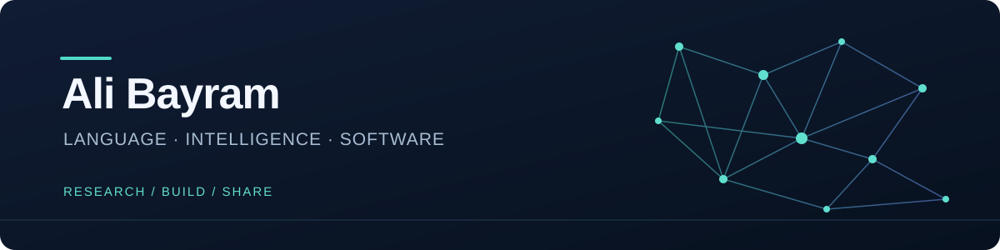

  

  <a href="https://huggingface.co/alibayram">Hugging Face</a> &nbsp;·&nbsp;
  <a href="https://linkedin.com/in/mehmetalibayram">LinkedIn</a> &nbsp;·&nbsp;
  <a href="https://www.youtube.com/channel/UC6xZXR2zd76Jx13-3u39wQA">YouTube</a> &nbsp;·&nbsp;
  <a href="mailto:malibayram20@gmail.com">Email</a>

I work at the intersection of **language models, multilingual NLP, and software engineering**. My research explores how language models can better represent Turkish and other languages, while my engineering work turns ideas into useful applications and learning tools.

I'm especially interested in tokenization, model adaptation and evaluation, healthcare NLP, and making AI concepts accessible through open-source projects and teaching.

## Selected work

| Project | What you'll find |
| :--- | :--- |
| [**LLM from Scratch**](https://github.com/malibayram/llm-from-scratch) | A hands-on journey through building large language models. |
| [**Turkish BERT**](https://github.com/malibayram/turkish-bert) | A PyTorch BERT implementation for Turkish, with morphology-aware tokenization. |
| [**Tokenizer**](https://github.com/malibayram/tokenizer) | Linguistically informed tokenization for multilingual text. |
| [**Tokenizer Benchmark**](https://github.com/malibayram/tokenizer_benchmark) | Tools and experiments for evaluating tokenizers. |
| [**Single Letter Transformers**](https://github.com/malibayram/single_letter_transformers) | Small, from-scratch implementations of modern language model architectures. |
| [**Model Architectures**](https://github.com/malibayram/model-architectures) | An experimental platform for prototyping and evaluating language models. |

## Research & practice

**Language models** · Training, fine-tuning, model merging, and evaluation for Turkish and multilingual NLP.

**Language representation** · Tokenization, morphology, embeddings, and benchmarks for language technologies.

**Applied AI** · Healthcare language models and data-quality-aware learning, alongside practical applications built with Flutter and cloud services.

**Teaching & open source** · Courses, demonstrations, and code that make machine learning and software development easier to explore.

## Tools I work with

`Python` &nbsp; `PyTorch` &nbsp; `TensorFlow` &nbsp; `Hugging Face` &nbsp; `Flutter` &nbsp; `Dart` &nbsp; `Firebase` &nbsp; `Docker`

## Latest videos

<!-- BLOG-POST-LIST:START -->
- [Magibu Uygulamalı Yapay Zekâ Mimarisi | Hafta 5, Gün 2: Final ve Türkçe Foundation Model Vizyonu](https://www.youtube.com/watch?v=mmb-9wMNj6s)
- [Magibu Uygulamalı Yapay Zekâ Mimarisi | Hafta 5, Gün 1: Tool Call, Code Execution](https://www.youtube.com/watch?v=0ACbr-fNWv0)
- [MAGIBU Makale Okuma Oturumu: Byte Flow Network ve Yeni Nesil Tokenizer Mimarileri](https://www.youtube.com/watch?v=nwXJAzr5iEQ)
- [Magibu Uygulamalı Yapay Zekâ Mimarisi | Hafta 4, Gün 2: RAG, Chunking ve Vektör Veritabanları](https://www.youtube.com/watch?v=X8hvbvCigzc)
- [Magibu Uygulamalı Yapay Zekâ Mimarisi | Hafta 4, Gün 1: Embedding Modelleri ve Anlamsal Arama](https://www.youtube.com/watch?v=LNkSTDezw8g)
<!-- BLOG-POST-LIST:END -->

Building, learning, and sharing — one experiment at a time.

