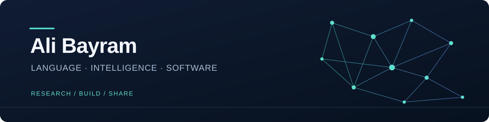

<a href="README.md">English</a> · <b>Türkçe</b>

<a href="https://magibu.ai"><b>Magibu ↗</b></a> &nbsp; / &nbsp; <a href="https://huggingface.co/alibayram">Modeller ve veri setleri</a> &nbsp; / &nbsp; <a href="https://www.linkedin.com/in/mehmetalibayram/">LinkedIn</a> &nbsp; / &nbsp; <a href="mailto:malibayram20@gmail.com">İletişim</a>

### Merhaba, ben Ali 👋

**Yapay zekâ araştırmacısı, ürün geliştiricisi ve [Magibu](https://magibu.ai) kurucusuyum.** Türkçenin ve yapay zekâda daha az temsil edilen dillerin daha iyi işlenmesi için dil modelleri, embedding modelleri ve geliştirici araçları üretiyorum.

Bir araştırma sorusunu çalışan bir uygulamaya taşımayı seviyorum: Bir model dili nasıl temsil etmeli, ne anladığını nasıl ölçmeliyiz ve bunu insanların kullanabileceği bir ürüne nasıl dönüştürebiliriz?

**Yıldız Teknik Üniversitesi Bilgisayar Mühendisliği doktoramı 2026'da tamamladım.** Araştırmalarımın yanında **Maltepe Üniversitesi** ve **İstanbul Bilgi Üniversitesi** bünyesinde ders veriyor, **Blue Sky Energy Technology** ile üretim ortamında yazılım geliştirme deneyimimi sürdürüyorum.

## 🧬 Dilden kullanışlı yapay zekâya

<table>
<tr>
<td width="50%" valign="top"><h3>🌈 EmbeddingMagibu</h3>
Türkçe odaklı anlamsal temsiller. Son çalışmalarım metin, görsel, ses ve videoyu bir araya getiren çok kipli aramaya uzanıyor.

<a href="https://huggingface.co/alibayram">Modelleri incele →</a> · <a href="https://ollama.com/alibayram/embeddingmagibu2">Yerel olarak çalıştır →</a>
</td>
<td width="50%" valign="top"><h3>🧪 TR-MMLU</h3>
<b>62 kategoride 6.200 soruyla</b> Türkçe dil modellerini değerlendiren bir benchmark. Dil ve bilgi yeteneklerini Türkçe bağlamında ölçmeye odaklanıyor.

<a href="https://huggingface.co/spaces/alibayram/turkish_mmlu_leaderboard">Sonuçları incele →</a>
</td>
</tr>
<tr>
<td width="50%" valign="top"><h3>🔡 Tokens with Meaning</h3>
Türkçe için biçimbilim odaklı ve hibrit tokenizasyon: Dilin yapısını modelin sözlüğüne taşımanın etkilerini araştırıyorum.

<a href="https://github.com/malibayram/Tokens_with_Meaning_A_Hybrid_Tokenization_Approach_for_NLP">Araştırma ve kod →</a> · <a href="https://huggingface.co/spaces/alibayram/turkish_tiktokenizer">Tokenizerı dene →</a>
</td>
<td width="50%" valign="top"><h3>🛠️ Sıfırdan LLM</h3>
Yaparak öğrenmek için tokenizasyon, embedding, attention, eğitim ve ince ayarlama konularını açan notebooklar ve ders materyalleri.

<a href="https://github.com/malibayram/llm-from-scratch">Geliştirmeye başla →</a>
</td>
</tr>
</table>

## 🌍 Sınırları aşan araştırma

**Sıradaki adım:** **2 Kasım 2026** tarihinde **CNRS / LORIA** bünyesinde doktora sonrası araştırmacı olarak başlayacağım.

- **İngiltere · 2026** — UniDive kısa süreli bilimsel araştırma ziyareti kapsamında Sheffield/Exeter'de Prof. Aline Villavicencio ile Türkçe–İtalyanca deyimsellik ve çok dilli model değerlendirmesi üzerine çalıştım. Devam çalışması Exeter Üniversitesi NLP Away Day etkinliğinde sunuldu.
- **Portekiz · 2023** — Instituto Politécnico de Tomar'da Erasmus doktora araştırma hareketliliği.
- **Avrupa araştırma ağları** — COST [CA21167 · UniDive](https://www.cost.eu/actions/CA21167/), [CA22115 · PhraConRep](https://www.cost.eu/actions/CA22115/) ve [CA24121 · KGELL](https://www.cost.eu/actions/CA24121/) çalışma grubu katılımları.

## 🚀 Araştırmadan ürüne

**[Magibu](https://magibu.ai)** çatısı altında dil modeli araştırmalarını kullanılabilir modellere, geliştirici araçlarına ve uygulamalı yapay zekâ eğitimlerine dönüştürmek için çalışıyorum. Flutter ve bulut servisleriyle uygulamalar ve etkileşimli öğrenme deneyimleri de geliştiriyorum.

Teoriyi, deneyleri, kodu ve gerçek kullanıcılarla çalışırken öğrendiklerimizi paylaşmayı seviyorum.

**Diğer açık kaynak çalışmalarım:** [Tokenizer](https://github.com/malibayram/tokenizer) · [Tokenizer Benchmark](https://github.com/malibayram/tokenizer_benchmark) · [Model Architectures](https://github.com/malibayram/model-architectures) · [Single Letter Transformers](https://github.com/malibayram/single_letter_transformers)

**Araçlarım:** `Python` · `PyTorch` · `TensorFlow` · `Hugging Face` · `Flutter` · `Dart` · `Firebase` · `Docker`

## 🎬 Birlikte öğrenelim

[YouTube kanalım](https://www.youtube.com/channel/UC6xZXR2zd76Jx13-3u39wQA) · [Son videolar](README.md#-learn-with-me) · [Magibu Akademi](https://magibu.ai)

---

<b>Üzerine çalışmak istediğiniz bir dil problemi veya geliştirmek istediğiniz bir fikir mi var?</b> <a href="https://www.linkedin.com/in/mehmetalibayram/">LinkedIn</a> veya <a href="mailto:malibayram20@gmail.com">e-posta</a> üzerinden tanışalım.

